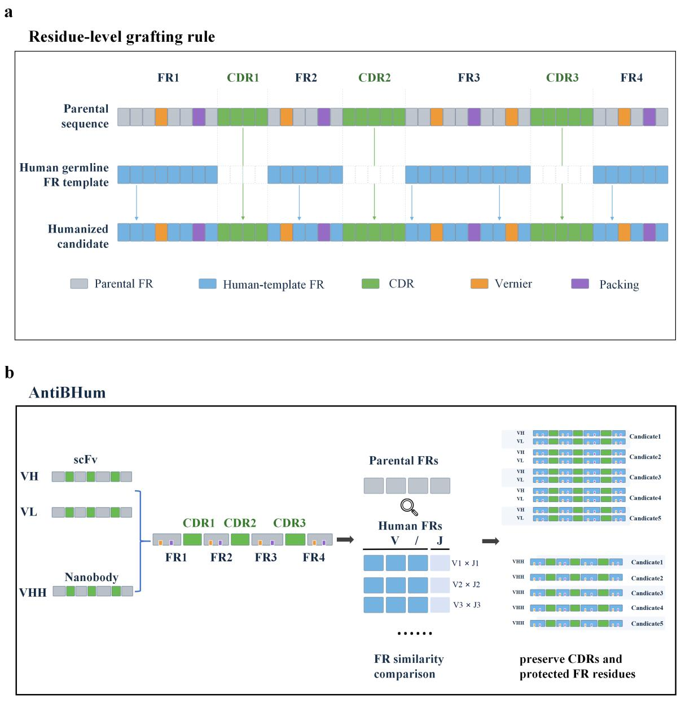
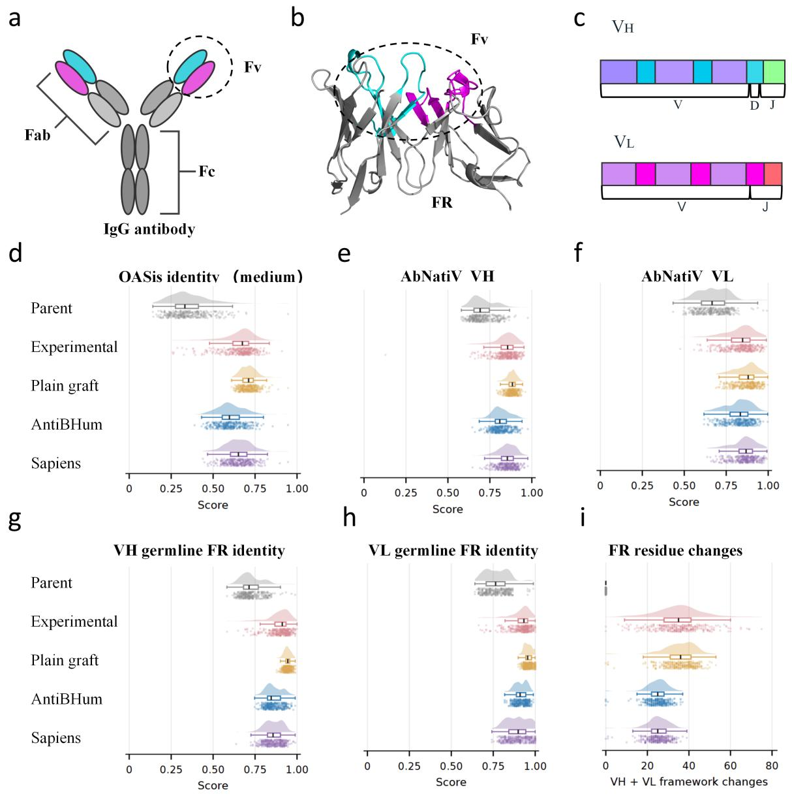
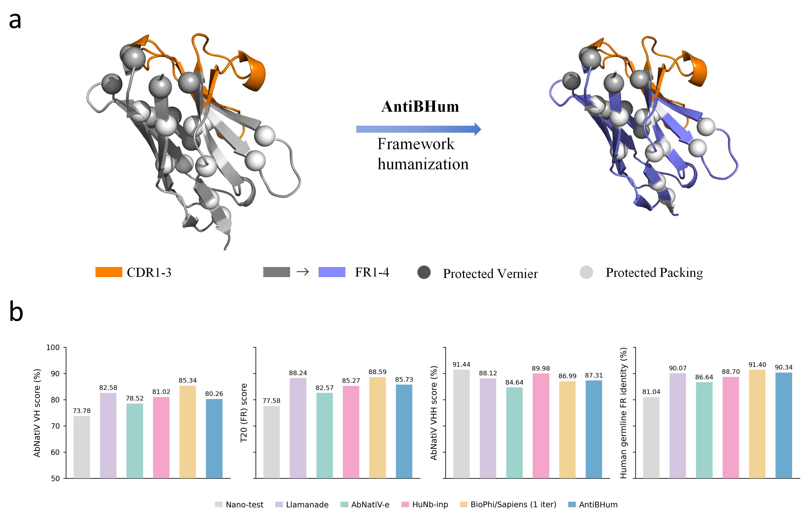

# AntiBHum

**Integrating template-guided design and experiment-derived residue constraints for antibody humanization**

[Installation](#installation) · [Examples](#run-the-examples) · [Options](#options) · [Release v0.1.4](https://github.com/SUAT-ZhiweiFengLab/AntiBHum/releases/tag/v0.1.4) · [Study reference](#study-reference) · [License](#license)

AntiBHum generates humanized antibody variable-region candidates by combining human germline template selection with retention of parental CDRs and designated Vernier and packing residues. The aim is to increase human-sequence similarity while preserving residues that support CDR geometry and framework interactions. It supports paired VH/VL sequences, scFvs, and single-heavy-domain VHH inputs.

The accompanying manuscript evaluates this approach using antibody and nanobody benchmarks and experimental studies of an FLT3-targeting scFv and a Trop2-targeting nanobody. The figures and research summaries below come from the supplied manuscript, *AntiBHum: Integrating Template-Guided Design and Experiment-Derived Residue Constraints for Antibody Humanization*, by Liu et al. They describe the study; the released CLI generates sequence candidates. Structural modeling, humanness scoring, comparator pipelines, and experimental assays are separate analyses and are not run by this CLI.

## Humanization workflow



**Figure 1. AntiBHum humanization workflow.** (a) Residue-level grafting preserves parental CDRs and designated Vernier and packing positions while replacing eligible framework residues. (b) Framework-prioritized V/J template retrieval generates candidates by matching V and J ranks; VH and VL candidates are paired by rank for scFvs.

1. **Annotate the input.** AbNumber and ANARCI number the variable domains and define Kabat FR1–FR4 and CDR1–CDR3.
2. **Retrieve human templates.** Human germline V and J segments are retrieved using `find_human_germlines(rank_by_frameworks=True)`. Retrieval uses an internal IMGT alignment and framework-priority ranking; it is not a Kabat-only framework identity calculation.
3. **Build ranked candidates.** Merge the V and J segments with matching ranks, convert the template to Kabat numbering, and substitute eligible framework positions. CDRs, protected residues, and positions not covered by the template retain their parental identity.
4. **Return the designed sequences.** VH and VL are humanized independently and paired by rank. scFvs are reconstructed with their input domain orientation and linker; VHH inputs use the heavy-domain workflow.

The default `--protected all` configuration retains both Vernier and packing positions. Protection rules are fixed in the implementation; the program does not learn new constraints from experimental data for each input. Candidate ranks reflect template ordering, not affinity or immunogenicity predictions. Figure 1 illustrates five candidates, whereas the CLI defaults to requesting nine templates per chain; see [Five-candidate design](#five-candidate-design).

## Antibody benchmark



**Figure 2. Antibody organization and computational comparison.** Panels (a–c) show IgG/Fv organization and VH/VL gene segments. Panels (d–i) compare OASis medium identity, AbNatiV VH/VL scores, human germline framework identity, and combined VH/VL framework substitutions across parental sequences, experimentally humanized references, plain grafting, AntiBHum, and Sapiens.

The manuscript's curated antibody set contains **339 independent parents** after deduplication and overlap exclusion; Figure 2 uses the **329 common evaluable parents** with valid results across all five groups. AntiBHum is represented by its first-ranked candidate and Sapiens by one humanization iteration. For parents with multiple experimental references, each metric is averaged within the parent before plotting.

The reported AntiBHum distributions show increased OASis and AbNatiV scores relative to parental sequences, with fewer framework substitutions than plain grafting. AntiBHum does not consistently maximize every humanness metric. These comparisons describe sequence-level properties and do not directly establish binding retention or reduced immunogenicity.

## Nanobody benchmark



**Figure 3. Nanobody humanization and computational assessment.** (a) Structural illustration of framework substitution while retaining parental CDRs and designated Vernier and packing residues. (b) Mean scores across the same 300 Nano300 sequences for unmodified inputs (Nano-test), Llamanade, enhanced-sampling AbNatiV (AbNatiV-e), HuNb-inp, one iteration of BioPhi/Sapiens, and AntiBHum.

The manuscript reports the following Nano300 means:

| Metric | Unmodified Nano-test | AntiBHum |
|---|---:|---:|
| AbNatiV VH humanness (%) | 73.78 | 80.26 |
| Framework T20 score | 77.58 | 85.73 |
| AbNatiV VHH nativeness (%) | 91.44 | 87.31 |
| Human germline framework identity (%) | 81.04 | 90.34 |

These results show higher human-sequence similarity together with a decrease in predicted VHH nativeness relative to unmodified inputs. AntiBHum does not lead every metric; the manuscript emphasizes balancing humanization with preservation of single-domain properties.

## Experimental study context

Beyond Figures 1–3, the manuscript reports ELISA evaluation of five AntiBHum candidates for each of the FLT3-targeting E4 scFv and Trop2-targeting nanobody 14_WT. All five E4 candidates retained binding, with ELISA EC50 values of 1.70–4.48 nM versus 6.64 nM for parental E4. All five 14_WT-derived candidates retained concentration-dependent binding, with EC50 values of 1.29–4.00 nM versus 2.28 nM for the parent; two had lower EC50 values and three had higher values than the parent.

These are results for the tested molecules under the reported assay conditions, not a guarantee for new inputs. ELISA EC50 values are not equilibrium dissociation constants. The study does not establish reduced clinical immunogenicity or universal performance across targets.

## Installation

The current wheel is intended for **Linux x86_64 and CPython 3.10**. Other platforms require separate builds and validation. Conda supplies the ANARCI/HMMER backend; no C compiler, Cython, GPU, or CUDA installation is needed to run this workflow.

```bash
# Get the public interface, examples, and environment specification.
git clone https://github.com/SUAT-ZhiweiFengLab/AntiBHum.git
cd AntiBHum
conda env create -f environment.yml
conda activate antibhum

# Install only the required Python packages, avoiding unused ANARCII/Torch/CUDA dependencies.
python -m pip install --no-deps -r requirements.txt

# Download the published wheel and checksum into an ignored directory.
mkdir -p dist
curl -fL -o dist/antibhum-0.1.4-cp310-cp310-linux_x86_64.whl \
  https://github.com/SUAT-ZhiweiFengLab/AntiBHum/releases/download/v0.1.4/antibhum-0.1.4-cp310-cp310-linux_x86_64.whl
curl -fL -o dist/SHA256SUMS \
  https://github.com/SUAT-ZhiweiFengLab/AntiBHum/releases/download/v0.1.4/SHA256SUMS
(cd dist && sha256sum -c SHA256SUMS) &&
  python -m pip install --no-deps --upgrade dist/antibhum-0.1.4-cp310-cp310-linux_x86_64.whl
```

If the repository and environment already exist, enter the checkout, activate `antibhum`, and continue with the pip/download commands. Keep `--no-deps`: abnumber 0.4.4 declares an ANARCII dependency that can pull in Torch and CUDA packages, although this workflow uses the original ANARCI backend. This option assumes the dependencies in `environment.yml` have been installed.

The [0.1.4 wheel and SHA256SUMS](https://github.com/SUAT-ZhiweiFengLab/AntiBHum/releases/tag/v0.1.4) are published on GitHub Releases. The source archive contains the public interface, not the private native core; `pip install .` is not supported. Users need only the wheel and runtime dependencies, not the private build workspace.

The environment file records the main dependency versions rather than a complete lockfile. Installation in a clean Conda environment on a fresh machine has not been validated, and the Linux wheel is not manylinux-certified.

## Check the installation

```bash
python -c "import antibhum; from antibhum import _core; print(antibhum.__version__); print(_core.__file__)"
python -c "from abnumber import Chain; print(Chain('EVQLVETGAEVKKPGSSVKVSCKASGGTFSSYAISWVRQAPGQGLEWMGGIIPIFGTANYAQKFQGRVTITADESTSTAYMELSSLRSEDTAVYYCARGTVAGQGAFDIWGQGTMVTVSS', scheme='kabat').chain_type)"
```

The first command should print `0.1.4` and a native `.so` path inside the active environment. The second should print `H`; it actually runs the numbering backend. Importing abnumber alone does not verify ANARCI/HMMER operation.

## Run the examples

From the repository root:

```bash
# scFv input
python run_humanize_v5.py \
  --scfv examples/HL.fasta \
  --output examples/output/HL

# VHH input
python run_humanize_v5.py \
  --vhh examples/VHH.fasta \
  --output examples/output/VHH
```

Or run both with:

```bash
bash examples/run_example.sh
```

`antibhum` and `python -m antibhum` accept the same arguments as the compatibility script. `--vhh` uses the existing single-heavy-domain workflow and rejects light-chain or two-domain inputs. The tool does not identify whether an input is a VHH or apply an additional VHH-specific residue policy. The older `--scfv` single-domain input remains supported.

Each output directory contains only:

```text
humanized_results.csv
humanized_scfv.fasta
```

Warnings, failures, candidate counts, and optional reference comparisons are printed to the terminal. No report log is written. Reusing an output directory overwrites these two result files. For a manual test without overwriting earlier local results, use `--output examples/output/manual_HL` and `--output examples/output/manual_VHH`.

| Input | Record id | Input length | CSV rows | FASTA records | Output length |
|---|---|---:|---:|---:|---:|
| `HL.fasta` (scFv) | `E4_mAb` | 247 aa | 9 | 7 | 246 aa for complete scFv |
| `VHH.fasta` | `14_WT` | 122 aa | 9 | 9 | 122 aa |

HL has only seven available light-chain J templates. Ranks 8 and 9 contain only heavy-chain sequences in the CSV. The unnumbered terminal `G` is omitted, with a terminal warning. VHH CSV output contains a single `humanized_VHH_sequence` column. These inputs do not include reference FASTA files, so no reference coverage is computed. See [examples/README.md](examples/README.md).

### Five-candidate design

To request five rank-matched candidates, matching the candidate count illustrated in Figure 1 and selected for AntiBHum's experiments, set the template counts explicitly:

```bash
python run_humanize_v5.py \
  --scfv examples/HL.fasta --heavy-top 5 --light-top 5 \
  --output examples/output/HL_top5

python run_humanize_v5.py \
  --vhh examples/VHH.fasta --heavy-top 5 \
  --output examples/output/VHH_top5
```

The standard example script retains the CLI defaults of nine templates. Output ranks are template ranks. Matching the candidate count does not certify identity with the experimentally tested constructs; their exact sequences are listed in the manuscript Supplementary Information. These commands do not reproduce external scoring, structure prediction, or wet-lab measurements.

## Options

| Option | Default | Meaning |
|---|---|---|
| `--scfv` | None | scFv FASTA; also supports a single variable domain |
| `--vhh` | None | VHH FASTA through the single-domain workflow |
| `--heavy` / `--light` | None | Separate chain FASTA files; at least one is required in this mode |
| `--output` | Required | Output directory |
| `--seq-id` | All records | Process only this FASTA id; error if absent |
| `--heavy-top` / `--light-top` | 9 / 9 | Requested template counts, positive integers |
| `--protected` | `all` | `all`, `vernier`, or `packing` |
| `--rank-mode` | `fr` | Framework-priority ranking; `full` uses the entire V region |
| `--pair-j` | `same` | Match V/J ranks; `top1` fixes J to the top result |
| `--verify-ref` | None | Reference FASTA; print sequence comparisons and coverage to the terminal |

Input modes are mutually exclusive, except that `--heavy` and `--light` can be paired. Separate chains are paired by FASTA id and rank; no linker is inferred, so the FASTA output is empty in this mode. FASTA ids are the first whitespace-delimited header token and must be unique within each file. Only the 20 standard amino acids are accepted; lowercase is converted to uppercase.

Missing files, invalid arguments, absent ids, input parsing failures, or no candidates result in a nonzero exit status. If some records fail, valid results may still be written. Insufficient templates or reference mismatches do not cause a nonzero exit status. Check terminal diagnostics. A failed template may leave a gap in candidate ranks.

CSV columns depend on the input mode:

- scFv or separate-chain input: `date`, `template`, `seq_id`, `humanized_VH_sequence`, `humanized_VL_sequence`.
- `--vhh` input: `date`, `template`, `seq_id`, `humanized_VHH_sequence`.

There is no combined scFv sequence column in CSV. Use `--vhh` to request the VHH schema; a single domain passed with `--scfv` retains the VH/VL schema. `humanized_scfv.fasta` contains complete scFv candidates or single-domain sequences, including VHH. Identical candidate sequences are not deduplicated.

## Method and limitations

- Numbering and grafting boundaries use Kabat. Only nonprotected framework positions covered by the template are replaced; CDRs, protected positions, and uncovered positions are preserved.
- Germline retrieval uses abnumber's IMGT alignment and framework-priority ranking, including similarity scoring. It is not equivalent to a Kabat-only framework identity score.
- V and J templates are paired by rank by default; this does not search all V/J combinations for a joint optimum.
- Protection uses fixed Vernier/packing positions based on the numeric Kabat position. Insertions sharing that number share the protection rule. The manuscript describes experimentally informed constraints; this CLI applies the fixed residue lists implemented in the core rather than inferring molecule-specific functional tolerance.
- Outputs retain numbered variable domains and the interdomain linker. Unnumbered terminal fragments, tags, and constant regions are omitted. Domain boundaries should be reviewed. Only one or two variable domains are supported.
- Sequence generation and residue-preservation tests alone do not establish affinity, stability, immunogenicity, or experimental performance. The bundled parental sequences match E4_mAb and 14_WT in the manuscript Supplementary Information; see [example provenance](examples/README.md#input-provenance).

## Tests and distribution

After installing the wheel and backend, run:

```bash
python -m unittest discover -s tests -v
python tools/check_release.py
```

Tests cover scFv orientation, single-domain output, VHH residue preservation, input validation, native loading, CLI behavior, and the absence of output logs. Generated results are excluded from Git; `.gitkeep` preserves the empty output directory.

```text
LICENSE                 PolyForm Noncommercial License 1.0.0
NOTICE                  License scope and required notices
run_humanize_v5.py       Compatibility CLI entry point
src/antibhum/           Public interface and CLI
assets/figures/          Manuscript Figures 1–3 and extraction provenance
examples/               HL/VHH inputs and output directory
requirements.txt        Python packages installed with --no-deps
environment.yml         Conda backend environment
tests/                  Regression and distribution checks
tools/check_release.py  Public-tree and wheel file checks
```

Core source and build scripts live in a separate private workspace. Cython converts that source to C and then a native extension; only the extension and public interface are included in the wheel. This avoids distributing core Python source, but does not prevent binary reverse engineering. No speedup has been benchmarked. Keep the private workspace outside the public Git repository and publish only verified wheels, never source distributions or generated C files. Linux wheels are not yet certified as manylinux-compatible.

This tool uses [abnumber](https://github.com/prihoda/abnumber), [ANARCI](https://github.com/oxpig/ANARCI), and Biopython. Third-party dependencies retain their own license terms; see [NOTICE](NOTICE).

## Study reference

Cong Liu, Ouyang Mo, Gavin Hou, et al. *AntiBHum: Integrating Template-Guided Design and Experiment-Derived Residue Constraints for Antibody Humanization*. Supplied manuscript; a public manuscript URL, DOI, and final publication details have not been provided.

Figures 1–3 are embedded from the supplied manuscript without redrawing. Their source pages, image dimensions, and checksums are recorded in [figure provenance](assets/figures/README.md). The full manuscript, benchmark data, comparator pipelines, structure-prediction workflows, and experimental raw data are not bundled in this CLI repository.

## Repository scope and distribution

Publish this directory as its own Git repository. Keep the sibling private workspace, generated results, caches, and compiler intermediates outside the public commit. Run `python tools/check_release.py` before committing; once Git is initialized, it also inspects tracked files. The file checker does not replace review of file contents or previous commits.

## License

Original AntiBHum software and official binary distributions are licensed under the **[PolyForm Noncommercial License 1.0.0](LICENSE)**, the same standard license used by the HuDiff reference project. Its SPDX identifier is `PolyForm-Noncommercial-1.0.0`. The complete license governs permitted purposes, modification, redistribution, notices, patent provisions, and warranty limitations. Uses outside its permissions require a separate agreement with the applicable rights holders; contact the project maintainers through this repository.

This is a noncommercial software license, not an unrestricted MIT/Apache-style license. The compiled core can be distributed under these terms without publishing its implementation source. See [NOTICE](NOTICE) for required notices, scope, and third-party attribution.

The software license does not separately license the manuscript figures, example sequences, research data, or other non-software materials. They remain with their respective rights holders unless separately licensed. Provenance identifies their source and is not a separate grant of redistribution rights.

New wheel builds automatically embed LICENSE and NOTICE. Previously published 0.1.4 assets are not rewritten by adding these repository files. Distributors must provide the license terms or their URL and the required notices as specified in LICENSE; when shipping a wheel, include LICENSE and NOTICE with it. Use a new version when publishing a rebuilt wheel rather than replacing an existing asset silently.
